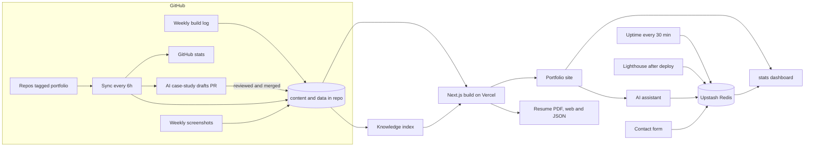

# Aftab Dhalait — a self-running developer portfolio

**Live:** [portfolio-aftab-nine.vercel.app](https://portfolio-aftab-nine.vercel.app) ·
[Engineering stats](https://portfolio-aftab-nine.vercel.app/stats) ·
[Build log](https://portfolio-aftab-nine.vercel.app/log) ·
[Resume (PDF)](https://portfolio-aftab-nine.vercel.app/resume.pdf)

[](https://github.com/Aftab5327/portfolio-aftab/actions/workflows/ci.yml)
[](https://github.com/Aftab5327/portfolio-aftab/actions/workflows/codeql.yml)
[](https://portfolio-aftab-nine.vercel.app/stats)
[](https://portfolio-aftab-nine.vercel.app/stats)
[](https://portfolio-aftab-nine.vercel.app/#projects)

<!-- Screenshot: add docs/screenshot.png (1600×900) and uncomment:

-->

A portfolio that keeps itself up to date. Tag a GitHub repo with `portfolio` and the
site syncs it, drafts a case study with AI for review, screenshots the live demo, adds
it to the AI assistant's knowledge, regenerates the resume, and starts monitoring its
uptime. No manual edits needed.

## Features

- **GitHub-driven projects:** repos tagged `portfolio` sync every 6 hours from their
  `PORTFOLIO.md` (or an approved AI draft, a manual entry, or repo metadata).
- **AI case-study drafts:** Groq writes drafts from each repo's README, file tree and
  commits, rejects invented numbers, and opens a PR for human review.
- **AI assistant with sources:** retrieval-augmented chat over the site's own content
  (MiniSearch), streaming answers, citations, validated tool actions, and an eval in CI.
- **Always-current resume:** ATS-friendly PDF, web and JSON Resume, generated at build
  time from the same data as the site.
- **Live engineering dashboard (`/stats`):** GitHub heatmap and languages, uptime of
  every deployed project, Lighthouse after each deploy, and AI-assistant topics
  (privacy-preserving).
- **Weekly build log:** an AI summary of real commits every Monday, published with
  links to the commits and an RSS feed.
- **Contact pipeline:** server-side form with honeypot, signed timing token, rate
  limit and optional Turnstile; email via Resend, an auto-reply, a Telegram ping, and
  leads stored for a small admin page.
- **Quality gates:** lint, types, retrieval eval, tool-call tests, resume checks,
  Lighthouse budgets on every preview, CodeQL, secret scanning, Dependabot with
  auto-merge.
- **Polish:** command palette (Ctrl/⌘ K), dark/light themes, accessible components,
  security headers, and a sitemap with OG metadata.

## Architecture



Content and committed data live in the repo, so every change is a reviewable commit.
Live metrics live in Redis and are never committed (a commit would trigger a deploy,
which would trigger Lighthouse, which would commit again).

## Tech stack

| Area | Tools |
|---|---|
| Framework | Next.js 14 (App Router), React 18, TypeScript (strict) |
| Styling | Tailwind CSS, framer-motion, hand-built SVG charts |
| Data validation | zod (every data file is validated at build time) |
| AI | Groq (`llama-3.1-8b-instant`), MiniSearch (BM25-style retrieval), react-markdown, mermaid |
| Resume | @react-pdf/renderer (bundled Inter font), JSON Resume |
| Storage | Upstash Redis (`@upstash/redis`, `@upstash/ratelimit`) |
| Messaging | Resend (email), Telegram Bot API, Cloudflare Turnstile (optional) |
| Automation | GitHub Actions, Playwright + sharp + pixelmatch (screenshots), Lighthouse |
| Quality and security | ESLint, retrieval eval, CodeQL, Gitleaks, Dependabot |
| Hosting | Vercel |

## How it's automated

- **[/automation](https://portfolio-aftab-nine.vercel.app/automation)**
  ([docs/automation.md](docs/automation.md)): every pipeline, workflow, data file and
  setting.
- **[/ai-assistant](https://portfolio-aftab-nine.vercel.app/ai-assistant)**
  ([docs/ai-assistant.md](docs/ai-assistant.md)): how the RAG assistant, its tools,
  guardrails and evaluation work.

## Local setup

```bash
git clone https://github.com/Aftab5327/portfolio-aftab.git
cd portfolio-aftab
npm install
cp .env.example .env.local      # fill in what you need; everything but GROQ_API_KEY is optional
npm run dev                     # http://localhost:3000
```

Useful scripts:

| Command | What it does |
|---|---|
| `npm run build` | Builds the knowledge index, then the site |
| `npm run sync` | Sync projects from GitHub → `data/projects.json` |
| `npm run draft` / `npm run approve <slug>` | AI case-study drafts / approve a reviewed draft |
| `npm run screenshots` | Capture live-demo screenshots (`npx playwright install chromium` first) |
| `npm run eval:rag` · `npm run test:chat` · `npm run check:resume` | Quality checks run in CI |

## Environment variables

Names only; see [`.env.example`](.env.example) for what each one does. Features whose
variables are missing are hidden or fall back gracefully.

| Variable | Used for |
|---|---|
| `NEXT_PUBLIC_SITE_URL` | Canonical URLs, sitemap, resume links, emails |
| `GROQ_API_KEY` | AI assistant, case-study drafts, build log |
| `GITHUB_TOKEN` | Higher GitHub API limits for local scripts |
| `UPSTASH_REDIS_REST_URL`, `UPSTASH_REDIS_REST_TOKEN` | Live metrics, analytics, rate limits, leads |
| `RATE_LIMIT_SALT` | Salted IP hashing for rate limits |
| `CONTACT_TOKEN_SECRET` | Signs the contact form's timing token |
| `RESEND_API_KEY`, `CONTACT_TO_EMAIL`, `CONTACT_FROM_EMAIL` | Contact emails and auto-reply |
| `TELEGRAM_BOT_TOKEN`, `TELEGRAM_CHAT_ID` | Contact notifications |
| `NEXT_PUBLIC_TURNSTILE_SITE_KEY`, `TURNSTILE_SECRET_KEY` | Optional spam protection |
| `ADMIN_USER`, `ADMIN_PASSWORD` | `/admin/leads` (404 when unset) |
| `SITE_URL` | Uptime script (GitHub Actions variable) |

## Credits

Content (text, images, resume) © Aftab Dhalait. The Inter font is licensed under the
SIL Open Font License ([assets/fonts/OFL.txt](assets/fonts/OFL.txt)).
