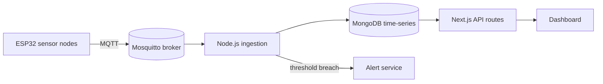

---
# Copy this file to the root of a project repo as PORTFOLIO.md, then add the
# `portfolio` topic to that repo on GitHub. Every field below is optional;
# anything you leave out falls back to the repo's GitHub metadata.

title: InfraSense 360
tagline: Smart-building monitoring that turns raw energy, water and occupancy sensor data into actionable dashboards.
category: IoT · Dashboard · Analytics
stack: [ESP32, MQTT, Node.js, Next.js, MongoDB, Docker]
featured: true          # featured projects are listed first
order: 1                # lower numbers come first (within featured / non-featured)
liveUrl: https://infrasense-demo.example.com   # falls back to the repo's "Website" field
image: docs/screenshot.png                      # repo-relative path (downloaded at sync) or a full https:// URL
# autoScreenshot: true                          # capture liveUrl and prefer it over `image`
resumeBullet: Cut abnormal-usage detection from ~2 weeks to under 5 minutes across a 6-floor pilot building.   # one impact line for the resume
---

## Problem

Facility managers had no single view of how a building consumed energy and water.
Readings lived in separate meters and spreadsheets, so waste was found weeks
after it happened.

## Solution

A network of **ESP32 sensor nodes** publishes readings over MQTT to a Node.js
ingestion service, which stores time-series data in MongoDB. A Next.js
dashboard shows live usage, trends and alerts per floor.

## Result

- Cut detection time for abnormal water usage from **~2 weeks to under 5 minutes**
- Identified **18% energy savings** from HVAC scheduling in the pilot building
- Dashboard used daily by 3 facility managers during the pilot

## Features

- Live per-floor energy, water, CO₂ and occupancy readings
- Threshold alerts by email and in-app notifications
- Historical trends with daily / weekly / monthly roll-ups
- Role-based access for admins and viewers

| Metric    | Sensor     | Interval |
|-----------|------------|----------|
| Energy    | PZEM-004T  | 10 s     |
| Water     | YF-S201    | 5 s      |
| CO₂       | MH-Z19B    | 30 s     |

## Challenges

- **Flaky Wi-Fi in basements:** added on-device buffering with retry so no
  readings are lost during outages.
- **Clock drift between nodes:** timestamps are assigned by the broker-side
  ingestion service instead of the devices.

## Architecture

See the [setup guide](docs/SETUP.md) for running it locally.
